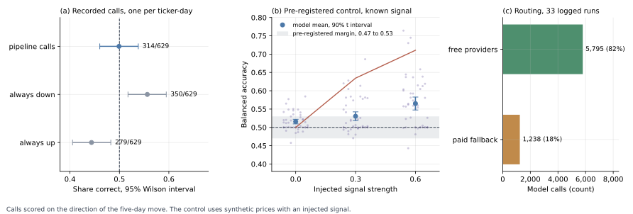
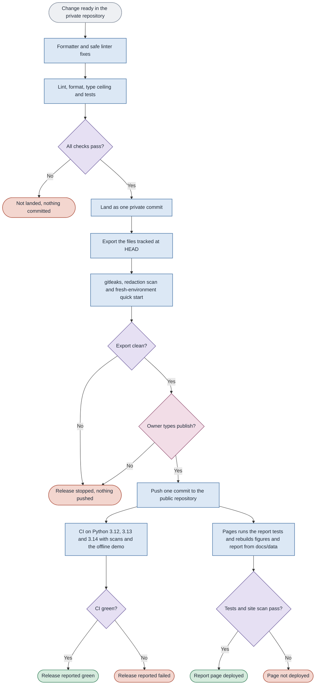
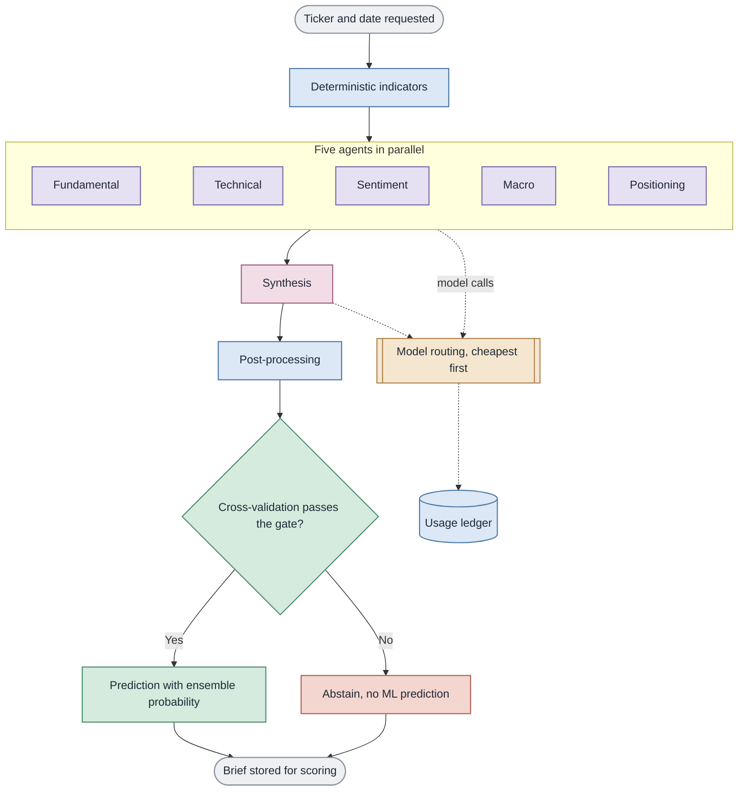
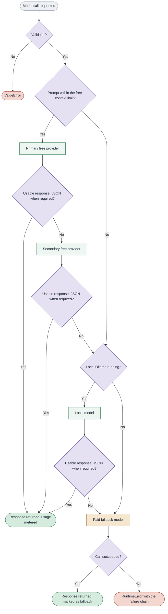
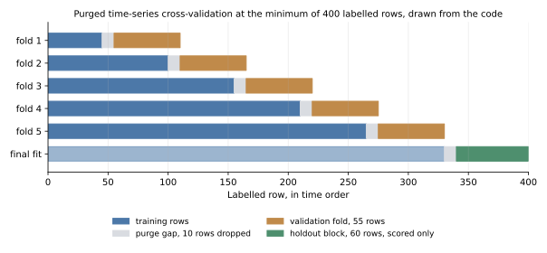
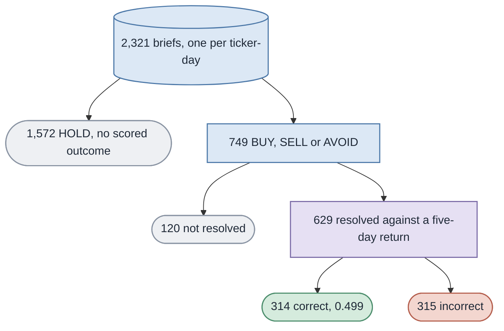
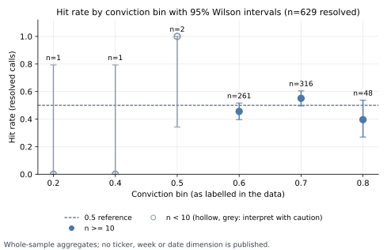
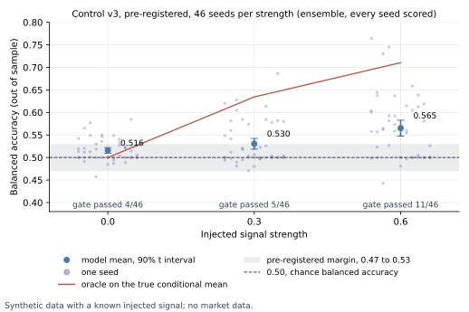
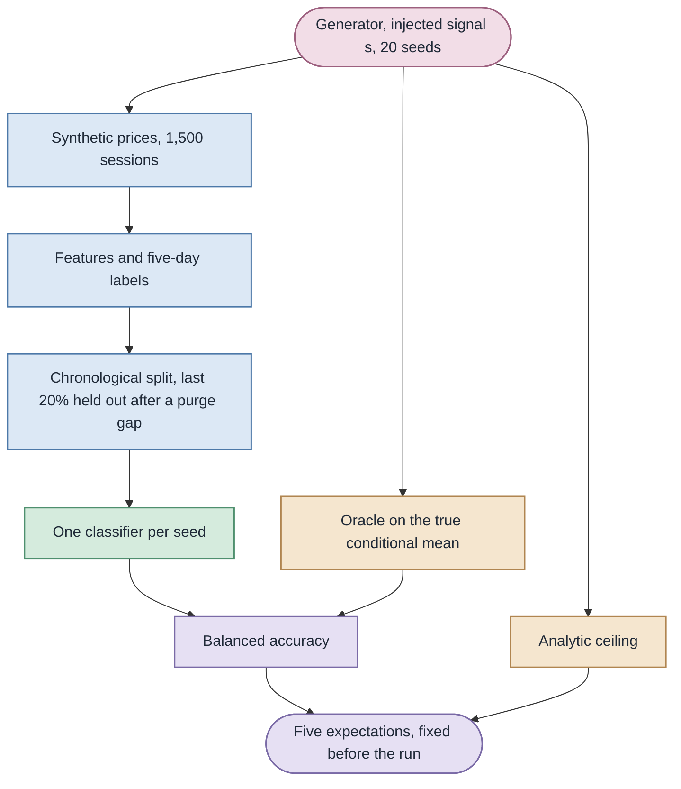

# agentic-equity-research

**An LLM research pipeline built and evaluated the way an ML research team would build it, with cost-governed model routing, leakage-tested ML behind a gate that can abstain, a pre-registered control experiment, and an evaluation that publishes its null result and its own correction.**

<p align="center"></p>

[](https://github.com/AdiMendelowitz/agentic-equity-research/actions/workflows/ci.yml)
[](https://adimendelowitz.github.io/agentic-equity-research/)
[](https://github.com/AdiMendelowitz/agentic-equity-research/issues/1)
[](pyproject.toml)
[](LICENSE)

> [!NOTE]
> A research demonstration, not investment advice and not a trading system. By default it runs offline on synthetic data and makes no model call.

**[Evaluation report](https://adimendelowitz.github.io/agentic-equity-research/)**, rebuilt from `docs/data` on every push by its own workflow, with the hash of each input in its footer.

[What it shows](#what-it-shows) · [Results](#results-at-a-glance) · [Engineering](#engineering-at-a-glance) · [Quick start](#quick-start) · [How it works](#how-it-works) · [Evaluation](#what-the-evaluation-found) · [Control experiment](#does-the-harness-detect-a-signal-that-exists) · [Tests](#what-the-tests-check) · [Limits](#limits) · [Roadmap](#roadmap)

## What it shows

- **Measurement before claims.** A pre-registered control injects a known signal into synthetic prices and checks that the harness finds it.
- **Engineering that holds up to review.** Over 1,100 tests, hermetic imports, leakage tests, a type-error ratchet, and secret and redaction scans back the code, and a CI matrix on Python 3.12, 3.13 and 3.14 runs after every public push.
- **Honest reporting.** The recorded calls show no measurable edge, a rule that always says down does better, and a counting error found in review was corrected in public with the old and new figures side by side.

## Results at a glance

- **The harness detects a signal that exists, under a known generator.** In the pre-registered control the two-model ensemble (only its LightGBM member is Platt-calibrated), scored on every seed whether or not the gate passed, reaches balanced accuracy 0.530 and 0.565 at the two non-zero signal strengths, both above 0.50 after a Holm adjustment, and stays within 0.03 of chance at zero signal. The zero-signal mean is itself 0.516, and the lower bound at 0.3 (0.519) lies inside the zero-signal interval. No test between signal strengths was pre-registered, so the control supports comparisons with 0.50 only.
- **No measurable edge on recorded output.** 314 of 629 resolved calls were correct (0.499, 95% Wilson interval 0.460 to 0.538, assuming independent calls), counting one decision per ticker and day, and detecting 0.55 against 0.50 would need about 780 independent calls under a two-sided test at the 5% level with 80% power. A rule that always says down scores 350 of 629 (0.556) on the same calls. These figures were corrected on 17 November 2026, and the correction note is under "What the evaluation found".
- **The ML gate rarely passes.** In the control it passed in 4 of 46 seeds with no signal and 11 of 46 at the strongest, a descriptive count and not a tested endpoint. A conformal gate is the next candidate, to be tested against matched-coverage selection.
- **The multi-agent design is not yet justified by evidence.** Nothing here compares the five agents with one well-prompted model on the same data; that comparison is on the roadmap.

## Engineering at a glance

| Area | What is in place | Where |
| --- | --- | --- |
| Model routing | Four-step provider cascade with the paid model only as fallback, and a usage ledger that counts calls without usage instead of estimating them | `src/aer/utils/llm_client.py`, `usage_meter.py` |
| ML | LightGBM and logistic regression, purged time-series cross-validation, out-of-fold Platt calibration, a holdout block no fit sees, and a gate that abstains | `src/aer/ml/` |
| Leakage | Future-bar mutation, label alignment, purge-gap geometry and holdout isolation tested | `tests/ml/test_leakage.py`, `tests/test_models_fixes.py` |
| Pre-registration | Specification and analysis code hashed in a public issue before the first results commit | `docs/prereg/control-v3.md`, [issue 1](https://github.com/AdiMendelowitz/agentic-equity-research/issues/1) |
| Reproducibility | Report and figures rebuilt from `docs/data` on every push, input hashes in the page footer, byte-identical figure builds tested, and one command that re-runs the control and the figures, compares the control CSV and the figure SVGs byte for byte with the committed files, and checks that the report page builds and is not empty | `docs/report/reproduce.py`, `.github/workflows/pages.yml` |
| Documentation | A data card and a model card, including the configuration that actually ran | [`docs/cards/`](docs/cards/model-card.md) |
| Release safety | Hermetic imports with sockets refused, redaction scan, gitleaks, licence audit and a mypy ceiling | `tests/test_hermetic.py`, `tools/` |
| Backtesting | A vectorised daily engine with next-day execution, explicit round-trip costs and empyrical metrics, written without `backtrader` | `src/aer/backtesting/`, `tests/backtesting/` |
| Decisions | Five architecture decision records, each naming the tests that enforce it | [`docs/adr/`](docs/adr/README.md) |

Every change is checked locally, released from a private repository as one exported commit, and checked again in public CI.



Blue steps run automatically, lavender diamonds are automatic checks, the rose diamond is the one human decision, green ends are success and terracotta ends are failures. The release script waits for the CI run and reports its result.

## Quick start

The package needs Python 3.12 to 3.14 (3.14 is the default) and [uv](https://docs.astral.sh/uv/).

```bash
uv sync
uv run aer-demo   # five synthetic tickers, offline, no model call
uv run python docs/report/reproduce.py --skip-control   # rebuild the figures, compare them with the committed ones, check the report builds
```

<details>
<summary>Sample output of <code>uv run aer-demo</code> (excerpt from a fresh-clone check: banner, two of five briefs, summary)</summary>

```text
SYNTHETIC DATA
No market data and no real company.
Demonstration output of a research pipeline. Not investment advice.
Author: Adi Mendelowitz

Brief: SYN4
  Sessions: 700
  Close: 93.79
  RSI: 33.56
  SMA50: 101.42
  Recent trend: FALLING
  ML gate: predicted, calibrated probability of an up move 0.69

Brief: SYN5
  Sessions: 700
  Close: 84.14
  RSI: 35.98
  SMA50: 88.66
  Recent trend: FALLING
  ML gate: abstained, cross-validation score below the gate threshold
  Cross-validated macro F1: 0.50

Tickers: 5, predicted: 1, elapsed seconds: 13.5
```

</details>

The demo computes indicators, signals and the ML gate locally on synthetic prices and scores its own output. Only the published aggregates in `docs/data` were scored on real output, and no real company appears in the demo.

## How it works



Blue boxes are deterministic code, lavender the agents, rose the synthesis model call, green the ML gate, terracotta an abstention and sand the routing layer, drawn as a predefined process and expanded below.

- **Multi-agent pipeline.** Five agents and one synthesis node built with LangGraph, in `src/aer/graph.py` and `src/aer/agents/`.
- **Python-first signals.** Thresholds and classifications run as deterministic code before any model call, in `src/aer/indicators/` and `src/aer/utils/python_replacements.py`.
- **Evaluation.** A scorer for recorded calls (direction of the five-day move, `weekly_scorer.py`), a scoring spec with a resolution rule for every output class of the synthetic demo, and power arithmetic, in `src/aer/evaluation/`.
- **Operations.** A prefetch manifest, a run heartbeat and run history, in `src/aer/prefetch/`, `src/aer/utils/pipeline_heartbeat.py` and `docs/data/run_history.csv`, where 22 of 29 scheduled runs completed with exit code 0.

### Cost-governed model routing

Each model call tries the free providers first and reaches the paid model only when they fail or the prompt exceeds their context limit. Of 7,033 model calls logged over 33 runs, 1,238 (18%) were served by the paid fallback.



Pale green steps cost nothing per call, sand is the paid model, lavender diamonds are checks, green ends return a response and terracotta ends raise an error. The cascade is in `src/aer/utils/llm_client.py` and the ledger in `src/aer/utils/usage_meter.py`.

### ML layer

LightGBM and logistic regression with purged time-series cross-validation, out-of-fold Platt calibration and a gate that abstains, in `src/aer/ml/`. The fold layout below is drawn by the code's own splitter and constants, so the picture cannot drift from the implementation.

<p align="center"></p>

## What the evaluation found

The evaluation found no measurable edge. The unit is the ticker-day, one brief per ticker and day. Of 2,321 ticker-days across 51 tickers, 629 were resolved against a five-day forward return, and 314 of those were correct, an accuracy on resolved actionable calls of 0.499 (95% Wilson interval 0.460 to 0.538). That interval contains 0.50. None of the 1,572 HOLD briefs received a scored correctness outcome, and 120 other briefs were not resolved, so this figure describes the resolved calls only.



**Correction, 17 November 2026.** The aggregates first published on 9 November counted same-day reruns of the pipeline as separate calls. Of the 2,609 rows first published, 288 were second or later runs of a ticker-day already in the store. The 78 of them that were resolved calls had been scored against the same five-day outcome as the first run, so they were not independent observations. Every figure on recorded output in this README and on the report page now counts one decision per ticker-day and keeps the first run of each day. The scored cohort moved from 342 correct of 707 (0.484) to 314 of 629 (0.499), and the resolved ML predictions from 74 correct of 145 to 64 of 120. Keeping the last run of each day instead gives the same 314 of 629, and 63 of 121 for the ML predictions. Under each counting rule, recorded accuracy stays close to 0.50. The cause, evaluation writes without a run identifier, is on the roadmap.

<p align="center"></p>

Detecting a hit rate of 0.55 against 0.50 with 80% power at a two-sided 5% level needs about 780 independent resolved calls (783 by `src/aer/evaluation/power.py`). The sample has 629, and overlapping five-day windows make the independent count lower. The published evaluation could not distinguish a small edge from none.

<details>
<summary>Results by conviction, recommendation and ML gate (descriptive only)</summary>

By conviction bin, the 0.6 bin scored 119 of 261 (0.456), the 0.7 bin 174 of 316 (0.551) and the 0.8 bin 19 of 48 (0.396). By recommendation, BUY scored 104 of 244 (0.426), SELL 107 of 217 (0.493) and AVOID 103 of 168 (0.613). All 1,572 HOLD rows were never resolved. The ML gate predicted on 139 of 2,112 rows, and 64 of the 120 resolved predictions were correct (0.533); those recorded predictions are the LightGBM member's direction, while the control scores the calibrated ensemble.

</details>

## Does the harness detect a signal that exists?

A null result means little unless the harness can find a signal when one is there. The control injects a signal of strength s into synthetic prices (1,500 sessions per seed) and scores balanced accuracy, whose expected value without skill is 0.50 at any class balance.

<p align="center"></p>

The current control, version 3, is pre-registered. It scores the two-model ensemble on 46 fresh seeds per strength, on every seed whether or not the gate passed, so it measures the estimator and not the system with abstention. Its specification, `docs/prereg/control-v3.md`, was released in a public commit and hashed in [issue 1](https://github.com/AdiMendelowitz/agentic-equity-research/issues/1) before the first public commit of the results; the seed count comes from a power calculation for a margin of 0.03.

| Signal strength s | Ensemble balanced accuracy, every seed | Pre-registered test | Verdict | Gate passed |
| --- | --- | --- | --- | --- |
| 0.0 | 0.516 | 90% interval 0.510 to 0.522 inside 0.47 to 0.53 | equivalent to 0.50 within 0.03: met | 4 of 46 seeds |
| 0.3 | 0.530 | one-sided 95% lower bound 0.519 (not adjusted for multiple comparisons), Holm-adjusted p below 0.001 | above 0.50: met | 5 of 46 seeds |
| 0.6 | 0.565 | one-sided 95% lower bound 0.547 (not adjusted for multiple comparisons), Holm-adjusted p below 0.001 | above 0.50: met | 11 of 46 seeds |

A rule that thresholds the true conditional mean stays 0.104 and 0.145 ahead at s = 0.3 and 0.6. At zero signal the model is inside the margin but slightly above 0.50; the report page carries an exploratory analysis of that excess, whose cause is not identified. The command is `uv run python docs/report/run_control_v3.py`.

<details>
<summary>Earlier versions of the control (1 and 2)</summary>

Version 2 used 20 seeds per strength. The model is one uncalibrated classifier per seed, chosen by the gate's cross-validation between LightGBM and logistic regression, with logistic regression when the gate abstains. The deployed calibrated ensemble is not what this measures. Model figures cover all 20 seeds.



Five expectations, defined in `src/aer/demo/control.py`, were written down before the run in the private development history, and all five were met. They check the oracle against the ceiling, that the zero-signal interval contains 0.50, that the interval at 0.6 lies above 0.50, that accuracy rises with s, and that at each signal strength the model's mean does not exceed the oracle's mean by more than the model's interval half-width. They are checks on one run, not five independent confirmations.

| Signal strength s | Model balanced accuracy (95% interval, normal multiplier 1.96) | Oracle balanced accuracy | Analytic ceiling | Gate predicted |
| --- | --- | --- | --- | --- |
| 0.0 | 0.481 (0.459 to 0.502) | 0.500 | 0.500 | 4 of 20 seeds |
| 0.3 | 0.531 (0.506 to 0.555) | 0.621 | 0.641 | 4 of 20 seeds |
| 0.6 | 0.574 (0.548 to 0.600) | 0.702 | 0.717 | 6 of 20 seeds |

<p align="center"></p>

The negative control was met narrowly. At zero signal the upper bound of the interval is only 0.002 above 0.50, and the mean sits below 0.50; the interval includes 0.50, which does not make the model equivalent to chance. At s = 0.6 the model's margin over chance is 0.074, against 0.202 for the oracle. The gate fired in 20%, 20% and 30% of seeds as the signal grew, and the paired comparison on the report page found no clear change in how often it passed.

The first run failed as a design and stays on record in `docs/data/detection_curve_run1.csv`. Its injected signal fed back on itself, which turned the strongest setting into a runaway trend, and raw accuracy tracked the label base rate. Version 2 removed the feedback and switched to balanced accuracy. The command is `uv run python docs/report/run_control.py`.

</details>

## What the tests check

- **Leakage.** `tests/ml/test_leakage.py` covers label alignment, future-bar mutation and purge-gap geometry. `tests/test_models_fixes.py` checks the purge gap before the holdout block, that no holdout row reaches any fit, and that the logged Brier score is out of fold.
- **Hermetic imports.** `tests/test_hermetic.py` imports every module in a fresh process with Python socket connections refused and no database file or credentials.
- **Data gates.** `tests/test_gates.py` checks the published data schemas and keeps the demo package out of ML and evaluation code.
- **Publication checks.** A redaction scan (`tools/redact_check.py`), a secrets scan (gitleaks) and a licence audit that fails on GPL and AGPL licence names in the locked environment run in CI.
- **Pre-registered analysis.** `tests/test_control_v3.py` pins the equivalence, Holm and paired-gap rules on hand-built cases and checks that the specification text states the same constants as the code.
- **Figures and README.** `tests/test_report_figures.py` rebuilds every figure twice and requires byte-identical output that matches the committed files. `tests/test_readme_figures.py` checks that the README figures use the pre-registered intervals and the code's fold layout, and that the counts in this README match the data they are drawn from.
- **Backtesting.** `tests/backtesting/test_engine.py` checks next-day execution, the cost of an entry, an exit and a flip, metrics against hand-computed values, and that changing a later price leaves every earlier result unchanged.
- **Types.** mypy runs in CI against a fixed ceiling of 62 known errors (`tools/mypy_ratchet.py`). A run above the ceiling fails; the ceiling is lowered by hand as errors are fixed, and it compares counts, not which errors.
- **Versions.** CI runs the test suite and a blocking offline demo on Python 3.12, 3.13 and 3.14.

## Limits

- Open defects found by outside review are tracked as public issues labelled known-limitation, with an overview in [issue 26](https://github.com/AdiMendelowitz/agentic-equity-research/issues/26).
- No real evaluation observation is published at row level, and the evaluation aggregates carry no ticker, week or date dimension. Synthetic control rows and run dates are published.
- Up to v0.1.2 the ML layer had three leakage defects, fixed in v0.1.3 with a test each. The calibration block followed the training block with no purge gap. The logged Brier score was computed on rows the model was fitted on. The Brier check scored the calibrated ensemble on the rows its calibrator was fitted on. Calibration is now fitted on out-of-fold predictions, and a purged holdout block is used only for evaluation.
- Control version 2 measures one uncalibrated classifier per seed, not the deployed ensemble; version 3 measures the ensemble with the gate's abstention not applied. In version 3 the model scores slightly above 0.50 on pure noise, within the pre-registered margin. In the exploratory analysis the pooled balanced accuracy is 0.5021 with a 95% seed-bootstrap interval of 0.4955 to 0.5085; that interval concerns this statistic only and does not rule out other forms of dependence, and the cause is not identified.
- Samples are small, with 629 resolved calls and 120 resolved ML predictions, counted one per ticker-day.
- Only the LightGBM member of the ensemble is Platt-calibrated, the logged out-of-fold Brier score belongs to the model chosen on the same folds, and the version 3 seed count was planned from version 2 variability, which the strongest signal slightly exceeded.
- The control's oracle thresholds the true conditional mean at the cost and is not the rule that maximises balanced accuracy; the analytic ceiling is for the zero-cost sign problem.
- The control experiment uses one synthetic signal family; it shows the harness can find that signal, not that real prices carry one.
- The control's expectations were fixed before its results in the private development history; each release here is a single commit, so that order cannot be checked from this repository. That applies to versions 1 and 2. From version 3 the specification is released in a public commit, and its hash posted in a public issue, before the first public commit of the results. The hashes for version 3 cover three files; the code they import is fixed by the release commit, and the start of the run is recorded only in a local log.
- The agents emit analysis and a confidence, not a directional call. Each per-agent opinion row therefore stores the synthesis recommendation, so a per-agent hit rate from those rows measures the synthesis and not the agent.
- The specification's own wording, that it was fixed before the run, claims more than this repository can show; the item above states what can be checked. Its lower bounds at the non-zero signals are individual one-sided bounds, not adjusted, beside Holm-adjusted p-values.
- Recorded calls are scored by direction at zero on adjusted closes, while the ML label is a five-day return above a 10 basis point cost on unadjusted closes, so the recorded ML accuracy and the training target are not the same quantity.
- The gate applies its cross-validation criteria to the better single model, and from this release the brief carries that model's prediction, with the two-model ensemble probability beside it. The 139 published ML predictions (120 resolved) were recorded under the earlier rule, which kept the LightGBM member's direction whichever model the gate chose. The holdout Brier comparison is logged as a diagnostic and gates nothing.
- The report page is deployed by its own workflow after the report tests and the redaction scan; it does not wait for the main CI run.
- Briefs are scored against a five-day move, while the underlying thesis spans weeks to months.
- The published aggregates were not re-scored with the HOLD rule, which was defined after they were seen.
- `numba` is overridden in `pyproject.toml` so that `pandas-ta` resolves on Python 3.14.
- LightGBM's `subsample` read 0.8 in earlier releases with no `subsample_freq`, so no fit made by this code, the control included, used row subsampling. It now reads 1.0, which states the configuration that ran and changes no fit.
- Live mode is absent.

## Roadmap

Planned next:

- An oracle check with the same target and threshold as the analytic ceiling, and a cause for the unexplained control result in the exploratory zero-signal analysis.
- Dependence-aware intervals for the live evaluation, with the method published.
- A conformal gate tested against matched-coverage selection, and a single-agent against multi-agent comparison.
- Indicators written in this repository in place of `pandas-ta`.
- Evaluation writes tagged with a run identifier and unique on ticker-day, so a rerun of the pipeline cannot add a second row for the same ticker-day.

## Author and licence

Built by Adi Mendelowitz ([adimendelowitz.dev](https://adimendelowitz.dev)). To cite this repository, use the "Cite this repository" button, which reads `CITATION.cff`.

MIT licence. This repository is a demonstration and is not investment advice.
