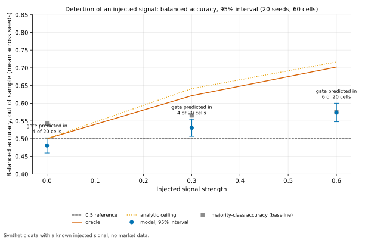
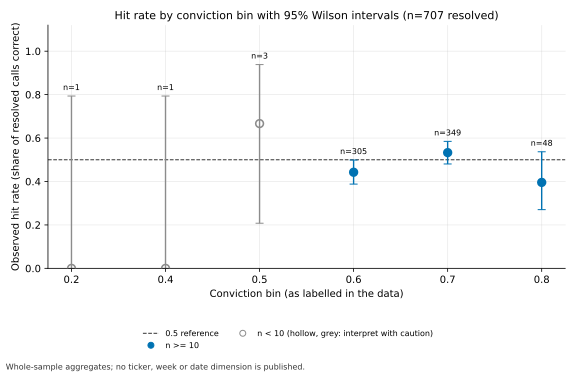

# agentic-equity-research

**A multi-agent LLM equity-research pipeline with cost-governed model routing, deterministic signal code, a calibrated ML gate that can abstain, and an evaluation that reports what it can and cannot detect.**

[](https://github.com/AdiMendelowitz/agentic-equity-research/actions/workflows/ci.yml)
[](pyproject.toml)
[](LICENSE)
[](https://github.com/psf/black)
[](https://github.com/astral-sh/ruff)

> [!NOTE]
> A research demonstration, not investment advice and not a trading system. By default it runs offline on synthetic data and makes no model call.

[Results](#results-at-a-glance) · [Quick start](#quick-start) · [How it works](#how-it-works) · [Evaluation](#what-the-evaluation-found) · [Control experiment](#does-the-harness-detect-a-signal-that-exists) · [Tests](#what-the-tests-check) · [Limits](#limits) · [Roadmap](#roadmap)

## Results at a glance

- **No measurable edge on recorded output.** 342 of 707 resolved calls were correct (0.484, about 0.45 to 0.52), and detecting 0.55 against 0.50 would need about 783 independent calls.
- **The harness detects a signal that exists, under a known generator.** On synthetic prices with an injected signal, a single classifier trained per seed has balanced accuracy above 0.50 at both non-zero strengths (0.531 and 0.574, against 0.621 and 0.702 for an oracle that knows the true conditional mean), and at zero signal its interval contains 0.50.
- **The ML gate does not yet separate signal from noise.** It predicted in 4 of 20 seeds with no signal and 6 of 20 at the strongest; a conformal gate is the next candidate, to be tested against matched-coverage selection.

<p align="center"></p>

## Quick start

The package needs Python 3.12 to 3.14 (3.14 is the default) and [uv](https://docs.astral.sh/uv/).

```bash
uv sync
uv run aer-demo   # five synthetic tickers, offline, no model call
```

<details>
<summary>Sample output of <code>uv run aer-demo</code> (excerpt from a fresh-clone check: banner, two of five briefs, summary)</summary>

```text
SYNTHETIC DATA
No market data and no real company.
Demonstration output of a research pipeline. Not investment advice.
Author: Adi Mendelowitz

Brief: SYN4
  Sessions: 700
  Close: 93.79
  RSI: 33.56
  SMA50: 101.42
  Recent trend: FALLING
  ML gate: predicted, calibrated probability of an up move 0.36

Brief: SYN5
  Sessions: 700
  Close: 84.14
  RSI: 35.98
  SMA50: 88.66
  Recent trend: FALLING
  ML gate: abstained, cross-validation score below the gate threshold
  Cross-validated macro F1: 0.48

Tickers: 5, predicted: 1, elapsed seconds: 13.0
```

</details>

The demo computes indicators, signals and the ML gate locally on synthetic prices and scores its own output. Only the published aggregates in `docs/data` were scored on real output, and no real company appears in the demo.

## How it works

<p align="center"></p>

Blue boxes are deterministic code, lavender the agents, rose the synthesis model call, green the ML gate and the free providers, sand the paid fallback and terracotta an abstention.

- **Multi-agent pipeline.** Five agents and one synthesis node built with LangGraph, in `src/aer/graph.py` and `src/aer/agents/`.
- **Cost-governed routing.** A four-step provider cascade that reaches the paid model only when the free options fail or a prompt exceeds their context limit, with a ledger that counts calls without usage instead of estimating them, in `src/aer/utils/llm_client.py` and `src/aer/utils/usage_meter.py`.
- **Python-first signals.** Thresholds and classifications run as deterministic code before any model call, in `src/aer/indicators/` and `src/aer/utils/python_replacements.py`.
- **ML layer.** LightGBM and logistic regression with purged time-series cross-validation, Platt calibration and a gate that abstains, in `src/aer/ml/`.
- **Evaluation.** An evaluation spec with a resolution rule for every output class, and power arithmetic, in `src/aer/evaluation/`.
- **Operations.** A prefetch manifest, a run heartbeat and run history, in `src/aer/prefetch/`, `src/aer/utils/pipeline_heartbeat.py` and `docs/data/run_history.csv`, where 22 of 29 scheduled runs completed with exit code 0.

## What the evaluation found

The evaluation found no measurable edge. Of 2,609 briefs across 51 tickers, 707 were resolved against a five-day forward return, and 342 of those were correct, an accuracy on resolved actionable calls of 0.484 (about 0.45 to 0.52 by normal approximation). That interval contains 0.50. None of the 1,766 HOLD briefs received a scored correctness outcome, and 136 other briefs were not resolved, so this figure describes the resolved calls only.

<p align="center"></p>

<p align="center"></p>

Detecting a hit rate of 0.55 against 0.50 with 80% power at a two-sided 5% level needs about 780 independent resolved calls (783 by `src/aer/evaluation/power.py`). The sample has 707, and overlapping five-day windows make the independent count lower. The published evaluation could not distinguish a small edge from none.

<details>
<summary>Results by conviction, recommendation and ML gate (descriptive only)</summary>

By conviction bin, the 0.6 bin scored 135 of 305 (0.443), the 0.7 bin 186 of 349 (0.533) and the 0.8 bin 19 of 48 (0.396). By recommendation, BUY scored 114 of 276 (0.413), SELL 121 of 246 (0.492) and AVOID 107 of 185 (0.578). All 1,766 HOLD rows were never resolved. The ML gate predicted on 169 of 2,374 rows, and 74 of the 145 resolved predictions were correct (0.510).

</details>

## Does the harness detect a signal that exists?

A null result means little unless the harness can find a signal when one is there. The control injects a signal of strength s into synthetic prices (20 seeds per strength, 1,500 sessions each) and scores balanced accuracy, whose expected value without skill is 0.50 at any class balance. The model is one uncalibrated classifier per seed: the gate's cross-validation picks LightGBM or logistic regression, with logistic regression when the gate abstains. The deployed calibrated ensemble is not what this measures. Model figures cover all 20 seeds.

<p align="center"></p>

Five expectations, defined in `src/aer/demo/control.py`, were written down before the run in the private development history, and all five were met. They check the oracle against the ceiling, that the zero-signal interval contains 0.50, that the interval at 0.6 lies above 0.50, that accuracy rises with s, and that the model does not exceed the oracle. They are checks on one run, not five independent confirmations.

| Signal strength s | Model balanced accuracy (95% interval) | Oracle balanced accuracy | Analytic ceiling | Gate predicted |
| --- | --- | --- | --- | --- |
| 0.0 | 0.481 (0.459 to 0.502) | 0.500 | 0.500 | 4 of 20 seeds |
| 0.3 | 0.531 (0.506 to 0.555) | 0.621 | 0.641 | 4 of 20 seeds |
| 0.6 | 0.574 (0.548 to 0.600) | 0.702 | 0.717 | 6 of 20 seeds |

The negative control was met narrowly. At zero signal the upper bound of the interval is only 0.002 above 0.50, and the mean sits below 0.50; this shows no false detection here, not that the model is equivalent to chance. At s = 0.6 the model's margin over chance is 0.074, against 0.202 for the oracle. The gate fired in 20%, 20% and 30% of seeds as the signal grew, so its F1 threshold showed no useful discrimination here.

The first run failed as a design and stays on record in `docs/data/detection_curve_run1.csv`. Its injected signal fed back on itself, which turned the strongest setting into a runaway trend, and raw accuracy tracked the label base rate. Version 2 removed the feedback and switched to balanced accuracy. The command is `uv run python docs/report/run_control.py`.

## What the tests check

- **Leakage.** `tests/ml/test_leakage.py` covers label alignment, future-bar mutation and purge-gap geometry.
- **Hermetic imports.** `tests/test_hermetic.py` imports every module with no network, database or credentials.
- **Data gates.** `tests/test_gates.py` checks the published data schemas and keeps the demo package out of ML and evaluation code.
- **Publication checks.** A redaction scan (`tools/redact_check.py`), a secrets scan (gitleaks) and a licence audit that fails on GPL and AGPL licence names in the locked environment run in CI.
- **Not yet covered.** No test checks the boundary between the training and calibration blocks; see Limits.
- **Versions.** CI runs the test suite and a blocking offline demo on Python 3.12, 3.13 and 3.14.

## Limits

- No real evaluation observation is published at row level, and the evaluation aggregates carry no ticker, week or date dimension. Synthetic control rows and run dates are published.
- Two known defects in the ML layer, fixed in the next release: the calibration block directly follows the training block with no purge gap, so five-day labels overlap at the boundary; and the logged Brier score is computed on rows the model was fitted on, so it is not out of sample.
- Samples are small, with 707 resolved calls and 145 resolved ML predictions.
- The control experiment uses one synthetic signal family; it shows the harness can find that signal, not that real prices carry one.
- The control's expectations were fixed before its results in the private development history; each release here is a single commit, so that order cannot be checked from this repository. From v0.2 each specification's hash is published in a public issue before its run.
- Briefs are scored against a five-day move, while the underlying thesis spans weeks to months.
- The published aggregates were not re-scored with the HOLD rule, which was defined after they were seen.
- `numba` is overridden in `pyproject.toml` so that `pandas-ta` resolves on Python 3.14.
- Live mode is absent.

## Roadmap

Planned next:

- A static results report on GitHub Pages with per-seed control results, a sample-accounting diagram for the live evaluation, and simple baselines.
- A purge gap before the calibration block, out-of-fold Brier scores, and the control run on the deployed calibrated ensemble.
- A fresh zero-signal run through the complete pipeline, and an oracle check with the same target and threshold as the analytic ceiling.
- Dependence-aware intervals for the live evaluation, with the method published.
- A conformal gate tested against matched-coverage selection, and a single-agent against multi-agent comparison.
- Indicators written in this repository in place of `pandas-ta`.

## Author and licence

Built by Adi Mendelowitz ([adimendelowitz.dev](https://adimendelowitz.dev)). To cite this repository, use the "Cite this repository" button, which reads `CITATION.cff`.

MIT licence. This repository is a demonstration and is not investment advice.
